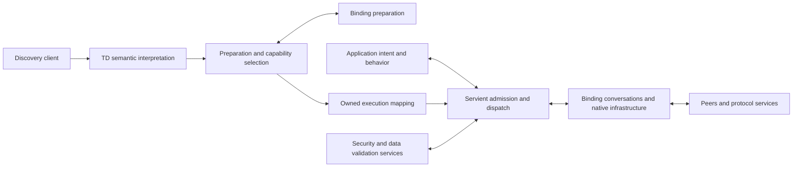

# General SPI architecture: WoT semantics, execution authority and native resources

Status: DISCUSSING — recommended architecture, awaiting Owner decision.

This proposal recommends the architecture for a protocol-independent Rust WoT
Engine. It replaces this topic's earlier broad capability/package proposals;
[their original text remains in Git](https://github.com/yushun1990/clinkz-wot/blob/d67dba8fc9894546ac177f217ff41917dbb96aaa/workspace/0076-composable-capabilities-and-runtime-boundaries.md).
[Review 08](../docs/reviews/review-08-integrated-architecture-reassessment.md)
remains a historical, non-normative reassessment. This proposal changes no active
specification, ADR, implementation, admission, gate or milestone.

## Recommended decision

**Build a semantic Engine with separate execution capabilities, over
Binding-owned protocol runtimes.** The common boundary expresses WoT intent,
selected mapping, current permission, owned work and observable outcomes.
It does not prescribe a common network request, session, server or task model.

Adopt these responsibility decisions together:

- TD owns description meaning; Planning prepares supported interactions and
  checks coverage. Prepared execution data is distinct from permission to use it.
- Core defines protocol-independent interaction, validation, security and
  ownership contracts. Servient owns live logical instances, admission,
  authorization, application dispatch and retirement of accepted work.
- A Binding owns interpretation of its protocol vocabulary, native matching,
  conversations, I/O and physical infrastructure. Native progress can occur
  independently of a particular Thing's semantic acceptance.
- Finite Consumer interactions, notification conversations, Producer exposure
  and Discovery have different control contracts. No universal `execute`
  method or mandatory symmetric client/server pair is selected.
- Description/definition reuse, logical instances, operations and physical
  resources have independent identities and lifetimes. Sharing is permitted
  only through explicit compatible owners and leases; it grants no authority.
- Normalize shared semantics once and execute from owned prepared data. Permit
  bounded preparation when an operation is first used, and owned incremental
  Binding preparation; do not require native compilation of every TD operation
  or a universal compiled-program representation.
- Keep the current acyclic Core/TD/Planning direction and Cargo composition.
  Replace restrictions of the narrow Property Read adapters where necessary;
  do not wrap them into the general architecture through compatibility facades.

This preserves the goals in
[System Goals and Context](../docs/architecture/00-system-goals-and-context.md),
including all Property/Action/Event families, both WoT roles, discovery,
security and constrained execution. It makes no claim of support for every
future protocol or of currently implemented replacement capabilities.

## Basis: semantics first, mechanisms second

The first conceptual pass used the official specifications and the enduring
product goals before inspecting Rust implementation, active SPI contracts,
prior implementation proposals or Review 08. Its working notes remained
outside the repository. The model was then challenged against master
`d67dba8fc9894546ac177f217ff41917dbb96aaa`, accepted contracts, source,
existing tests and Review 08. Current architectural means described in the
goals document were treated as hypotheses, rather than product requirements.

The following distinction matters throughout this proposal:

| Basis | What it establishes | What it does not establish |
| --- | --- | --- |
| [WoT Architecture 1.1 §§6.5–6.7](https://www.w3.org/TR/2023/REC-wot-architecture11-20231205/#sec-interaction-model) | Affordances express state, processes and notifications; hypermedia controls describe their concrete activation. | A Rust SPI, compiler, scheduler, storage model or universal protocol shape. Its [abstract Servient implementation, §8](https://www.w3.org/TR/2023/REC-wot-architecture11-20231205/#sec-servient-implementation), is explicitly non-normative. |
| [TD 1.1 §§5–8](https://www.w3.org/TR/2023/REC-wot-thing-description11-20231205/#form) | Form operations, schemas, defaults, effective security, protocol mapping assertions and context extensions. | Guaranteed reachability, permission to act, support for all forms, or physical resource ownership. |
| [TD 1.1 §7.2/§8.3](https://www.w3.org/TR/2023/REC-wot-thing-description11-20231205/#protocol-bindings) | The target's URI scheme identifies the protocol; vocabulary extensions describe mapping details. HTTP-specific assertions apply to HTTP mappings. | A new ClinkZ protocol-matching vocabulary, mandatory-extension flag or Core protocol switch. |
| [TD 1.1 §7.3](https://www.w3.org/TR/2023/REC-wot-thing-description11-20231205/#adding-security-schemes) | Security schemes can be extended. Preserving a scheme and satisfying it are different capabilities. | Authorization from a TD or permission to downgrade an unsupported scheme. |
| [WoT Discovery Recommendation](https://www.w3.org/TR/2023/REC-wot-discovery-20231205/) | Introduction and exploration distribute descriptions, with security considerations and specified exploration services. | A Directory server inside the Engine or discovery as a Property operation. |
| ClinkZ product goals and this engineering decision | Bounded owners, deterministic selection, independent local authority, cancellation/cleanup truth and equivalent supported semantics across profiles. | W3C mandates for generations, permits, Rust traits, allocation budgets or package names. |

The [Binding Templates retirement notice](https://www.w3.org/TR/2025/NOTE-wot-binding-templates-20251104/)
redirects mechanism discussion to TD Bindings. The
[TD 2.0 Bindings chapter](https://www.w3.org/TR/2025/WD-wot-thing-description-2.0-20251104/#bindings)
and [Binding Registry](https://www.w3.org/TR/2025/DRY-wot-binding-registry-20251104/)
are useful direction and discovery aids, respectively a Working Draft and Draft
Registry. They do not supersede the TD 1.1 Recommendation baseline. A concrete
Binding documents which protocol/mapping specification and version it implements;
not every document listed by a registry is a W3C Recommendation.

### Fundamental constraints

1. **Description is not authority.** A TD id, endpoint, schema, compiled object,
   Rust type or numeric generation does not authorize execution or identify a
   live local owner. Anonymous Things and valid empty affordance names remain
   usable; the Engine supplies its own local identity.
2. **WoT semantics have one shared interpreter.** Common defaults, operation
   applicability, security-reference composition and schema meaning are not
   independently reinvented by each Binding. Protocol methods, topics, options,
   acknowledgements and native security exchanges stay outside semantic Core.
3. **Every accepted obligation has an owner.** Pending, cancellation, failure,
   partial installation and late success preserve the work and its release path.
   Replacing a slot never redirects old work to the successor.
4. **Logical roles do not determine network topology.** A WoT Producer may
   connect to a broker; a Consumer subscription may require a callback endpoint.
   One Thing is neither one connection nor one physical device.
5. **Support and failure are truthful.** Invalid description, unsupported
   combination, denied permission, exhausted capacity, failed communication
   and uncertain remote effect are different outcomes.
6. **Limits apply where enforced.** Engine admission bounds Engine retention
   and promised handoffs. Bindings bound native ingress/growth. Deployment
   owns OS/SDK failure containment. Numeric declarations alone prove neither
   transitive memory bounds nor preemption of linked code.

The exact generation/permit representation and the choice to keep bindings
startup-composed are ClinkZ decisions. The semantic/authority and logical/physical
distinctions are the enduring design principles behind them.

## Components and dependencies

| Component | Responsibility and boundary |
| --- | --- |
| TD | Preserve descriptions/extensions; inspect known TD structure; resolve shared defaults, form context, base/template and security/schema meaning. Produce bounded semantic views, retaining original coordinates for diagnostics. Interpretation of an HTTP method is not TD's job. |
| Planning / preparation | Build operation indexes and selected mapping data; coordinate Binding, codec, validator and security support; check actual compiler/executor/configuration pairing and Producer advertisement coverage. It performs no native I/O or credential acquisition. |
| Core | Define operation/target identity, data roles, common result checks, prepared validation/security execution contracts, authority/lease boundaries and observable lifecycle outcomes. It has no TD parser, protocol case or dependency on concrete Bindings. |
| Servient execution | Own consumed/exposed instances, current permission, publication, operation/invocation/subscription records, behavior dispatch, fair logical progress, diagnostics and cleanup ownership. Compose optional services without implementing their protocols. |
| Concrete Binding | Interpret its protocol vocabulary and mapping defaults; create native execution data; implement conversations, matching/captures, framing, correlation, native authentication integration, delivery and infrastructure lifecycle. It cannot choose an application handler or grant semantic acceptance. |
| Payload/validation services | Implement media decoding/encoding and evaluation of supported DataSchema constraints. Shared executable validation belongs below TD preparation and Servient; protocol/ecosystem payload adaptation may compose those services inside a Binding. |
| Security services | Resolve credential capabilities, verify evidence, establish principals and evaluate application policy. Core defines their neutral contracts; applications provision implementations. Bindings implement the wire/security-stack parts. |
| Discovery clients | Own introduction, exploration, retrieval and continuation workflows, with bounded results, cancellation and trust checks. Directory servers/storage remain outside this product boundary. |
| Application/platform | Link registrations, provide behavior and services, select storage/progress/limits, and own deployment, cutover and environment recovery. |

Dependencies, with `A -> B` meaning **A depends on B**:

```text
Core                        -> Foundation
TD                          -> Core, Foundation
Planning                    -> TD, Core, Foundation
Binding runtime             -> Core, selected native/platform/payload services
Binding preparation         -> Binding runtime, Planning, TD
Servient execution          -> Core, Foundation
Servient preparation facade -> Servient execution, Planning, TD
Discovery                   -> Core, TD, selected discovery adapters
Application                 -> selected capabilities and concrete implementations
```

There is no Core -> TD/Planning edge, including through optional features or
reexports. Planning and Servient do not name HTTP/MQTT/etc. Concrete Bindings do
not depend on Servient. Discovery may optionally reuse a Consumer adapter for a
Directory's described interactions; the shared Engine does not require that
path for every discovery mechanism. Codecs/verifiers can be composed services
without a new mandatory crate or a universal runtime backend.

The current package names are suitable. Complete the execution/preparation
feature boundary by moving physical output/reclaim owners to their execution
owner, rather than hiding an actual dependency behind a feature alias. Additional
crates are justified only by a concrete dependency or distribution need.

A third-party crate exports runtime registration constructors for its supported
facets and, optionally, preparation producing those same native program types.
The application supplies the complete registrations; generic Host erasure or
application-closed static types accept conforming downstream implementations
without a built-in protocol/compiler whitelist or workspace membership. Pairing
checks the actual executor's configuration, format and policy, not just a tag.
Registrations declare supported combinations, native progress/ingress limits,
visibility, delivery and retirement policy, and required codec/security services.
Runtime-only registrations retain no compiler. Missing roles require no dummy
components, and no Binding obtains an application-dispatch handle.

## Description, preparation, authorization and execution

These phases have different effects and validity conditions:

| Boundary | Data and result | Permitted effects |
| --- | --- | --- |
| Interpret description | Immutable input plus origin/base and supported context profile -> common semantic facts and structural diagnostics. | Bounded local work. Remote retrieval is a separate authorized workflow. |
| Prepare interaction | Operation/form facts plus actual registered capabilities -> selected native mapping, data/validation contract, security requirements and compatibility information. | Pure, bounded construction. No sockets, tasks, credentials or handler calls. |
| Admit current use | Instance, prepared mapping, call arguments, policy and capacity -> owned call/exposure/subscription and current execution grant. | Reserve retention/cleanup; acquire credential or verification capabilities as needed. Permission to attempt authentication is distinct from final authorization. |
| Perform | Owned grant/work plus dynamic operands -> Binding conversation -> validated semantic outcomes. | Authorized native I/O; permitted behavior dispatch only after inbound verification/authorization. |
| Retire | Revoke new work, cancel/drain existing owners -> complete, acknowledged ownership transfer, or explicitly retained residual obligation. | Bounded cleanup; final local release only when actual owners permit it. |

`consume` normalizes and indexes description meaning once. It need not lower all
native candidates eagerly: it can prepare an operation on first use through a
bounded, cancellable local job. The proposed default requires at least one
statically supported interaction and returns a per-operation support report;
a caller can require a stricter capability set. TD tooling remains usable with
no executable interaction. Missing credentials, current capacity and peer
reachability are runtime availability, not structural support certificates.

An operation cannot proceed until its complete selected mapping, validation,
security and necessary capacity checks succeed. Required preparation is not
optional; ahead-of-time compilation, caching and two-level plan storage are.
First-use latency and preparation failure are observable. A warmed execution
path uses indexed prepared data, never rescans a TD or reruns shared defaulting.
If optional caching is used, duplicate work/waiters and negative results need
bounded ownership; cached support never becomes a permanent permission.

First-use work belongs to the optional preparation coordinator above execution,
not to Core or a protocol callback. It consumes a bounded owned candidate
snapshot containing normalized common facts and the mapping's required extension
metadata. Its storage and lifetime are admitted separately from live calls;
irrelevant document content need not survive `consume`. Completion installs an
immutable mapping into a generation-checked preparation slot, without changing
instance authority. Source input can then remain destroyed. An execution-only
composition accepts prepared entries and reports preparation-required for an
unprepared operation; it never acquires an upward TD/Planning dependency.

TD preparation resolves base and validates URI templates. Per-call variables
are checked and expanded by the shared prepared URI mechanism under execution
budgets; the Binding then validates its native addressing constraints. No
protocol case is needed in that common mechanism. Policy and credential audience
checks cover the actual expanded destination, proxy and any permitted redirects
or continuation targets. A supplied TD or discovered link is not permission to
contact arbitrary referenced addresses.

A compiler can produce owned non-`Copy` data through incremental pure jobs.
Capacity precedes each acquisition; failure retains provisional output and a
funded rollback path. An atomic inline compiler remains an efficient optional
adapter. There is no universal all-native-bounds-before-any-pure-start barrier;
whole-input limits, required coverage and complete checks before native effects
remain. This deliberately renews the exercised Consumer subset's ordering and
cost evidence when its implementation changes.

## Definitions, instances and physical owners

| Concept | Identity and lifetime |
| --- | --- |
| Thing Model / source TD revision | Descriptive content. A reusable model is not automatically an executable definition or runtime Thing. |
| Prepared definition | Immutable shared semantic/native data with explicit dependencies. No credentials, live handlers, sessions, cancellation or local serving authority. |
| Binding implementation registration | Linked implementation plus immutable configuration, supported facets and resource/progress policy. Its identity is not a network endpoint or permission. |
| Logical Thing instance | Local consumed/exposed identity, description association, behavior/policy, generation and publication state. Several instances may refer to the same TD id or definition. |
| Admitted interaction | One call, action invocation, logical subscription or exposure participation, retaining its own authority, reservations and required leases. |
| Native infrastructure | Binding-owned sessions, listeners, connections, protocol registrations, queues and workers. It can serve many instances/roles and outlive any one interaction. |
| Deployment runtime | Executor/reactor/firmware/process owner. Its loss is an environment event, not successful completion of dependent cleanup. |

References to immutable backing retain its real physical owner and original
account until final destruction. Each instance and call pays for its own
operands, records and references. Do not copy data per instance merely because
it needs independent permission; do not share permission merely because bytes
are identical. A separately versioned Plan Set is needed only if independently
retained/replaced; ordinary instance publication does not intrinsically need a
second epoch.

Allow explicit prepare-once / checked-bind-many where a Binding can declare
invariant dependencies and valid operands. Both compilation and binding can
fail and must be funded. The compiler checks schemas, security meaning, native
policy and non-operand target facts; a name/hash/type match alone is insufficient.
A different endpoint can be an operand for one mapping and a true definition
dependency for another. Specialized per-instance preparation is also valid: no
Binding must manufacture a parameter language, common VM or `bind` abstraction
when it has no reusable work. Automatic interning, persistence and generated
images are optional later features, with their own trust/compatibility checks.

A live local reference identifies its issuer/registry, slot, generation and
particular admitted obligation, or has an equivalent lifetime/ownership proof.
Numeric equality is insufficient. Deferred input, wakes and completions remain
pinned to the original recipient. Accepted work keeps the original handler,
program, principal association and reply capability through settlement; it is
never looked up again by a recycled name or endpoint. Revocation stops new
acceptance and applies the configured cancellation policy to existing work.
Bindings additionally fence replaced native sessions and correlation namespaces;
old native work cannot inherit a new session's trust or reply capability.

## Execution capabilities and essential flows

The following are responsibility families, not a prescribed trait inventory.
One Binding can implement several facets using the same private driver. An
absent facet requires no dummy server, compiler or subscription implementation.



### Consumer finite interactions and Actions

A Consumer request identifies semantic target/operation, dynamic values and
control intent. Servient selects an allowed prepared candidate, checks current
policy and data, reserves result/cleanup capacity, and supplies a scoped grant
and operands to the Binding. The Binding returns an owned conversation before
effects; it performs however many messages the mapping requires. Responses
carry selected identity and the applicable data role/response classification.
The Engine validates these and the promised payload contract before delivery.

Property reads and writes, finite Action interactions and native collections
can use this family. It is not a universal transport RPC: the Binding may use
request/reply, publish plus correlated response, multiple messages or another
faithful described mapping. Return of a response, local delivery and actual
remote effect are separate facts. Retry after uncertain write/Action commitment
is a new explicit policy decision, never automatic candidate fallback. TD
`safe`/`idempotent` declarations inform policy but do not prove that an unknown
previous attempt had no effect.

**Action lifetime is independent of request lifetime.** Invocation can complete
with output, fail, or establish a continuing invocation where the selected
mapping provides one. A neutral local invocation reference retains that exact
mapping, opaque native continuation, instance and security association. Query
and cancel are further described operations targeting that invocation; they
can themselves be unsupported. The Engine invents neither a universal task URI
nor a remote task-state schema. Mapping/profile-defined status data remains
available, with only justified common execution certainty recorded by Core.

[TD 1.1 ActionAffordance, Table 6](https://www.w3.org/TR/2023/REC-wot-thing-description11-20231205/#actionaffordance)
already defines optional `synchronous`; absence makes no claim about
synchronicity. It does not mean synchronous-by-default. Likewise
[HTTP 202](https://www.rfc-editor.org/rfc/rfc9110.html#name-202-accepted)
does not prove process completion. Do not manufacture query/cancel support from
an HTTP status or the existence of an `invokeaction` form.

For a Producer, application behavior supplies the actual action process and
its query/cancel behavior. Servient owns the admitted invocation records and
binding association; a job may outlive the initiating response but cannot lose
its local task/cleanup owner. Handing a job to an application supervisor is an
explicit ownership transfer. Local timeout, dropping a future, or connection
closure never proves that a physical action stopped. Results distinguish local
revocation, requested remote cancellation and known remote terminal state.

### Notification conversations and Event emission

A logical observation/subscription owns establishment, control payloads,
delivery, optional reciprocal responses, stop and cleanup. Property observation
uses Property value semantics. Event delivery also accounts for the TD's
[subscription, data, dataResponse and cancellation schemas](https://www.w3.org/TR/2023/REC-wot-thing-description11-20231205/#eventaffordance).
Reducing both to an endless iterator of payloads would lose required control
and response opportunities. A delivered Event requiring `dataResponse` carries
a bounded owned reply capability with its own deadline/disposal obligation.
Protocol ACKs and semantic Event responses are separate.

Use an application-facing pull cursor, with asynchronous convenience adapters,
over owned conversation state. Wire push, callbacks or polling are Binding
choices. A bounded callback can enqueue native observations and wake progress;
it cannot invoke an application handler. Receiving application credit is not a
claim that the wire or remote publisher supports backpressure.

Each logical subscriber has an independent cursor, permission, limits and stop
state. Bindings may share native subscriptions and packet backing when matching,
authentication, QoS and delivery semantics are compatible. Matching determines
zero/many original logical recipients, not new Things inferred from arbitrary
topic text. Native acknowledgements/correlation remain with the actual native
owner. Fan-out references, work and queued bytes are separately bounded; a
single response opportunity cannot be duplicated across recipients.

Property updates can coalesce only under an explicit policy; Event loss cannot
be hidden as a newer state. Overflow must produce visible loss/termination or
supported backpressure without depending on the full queue to report it. An
initial observed value, ordering, replay, duplicates and loss guarantees are
capability properties, not invented Engine promises. For example,
[CoAP Observe](https://www.rfc-editor.org/rfc/rfc7641.html#section-3.6)
has protocol-specific cancellation, and
[MQTT 3.1.1 §3.3.5](https://docs.oasis-open.org/mqtt/mqtt/v3.1.1/os/mqtt-v3.1.1-os.html#_Toc398718042)
permits overlapping subscriptions whose logical recipients cannot be inferred
from packet count. These differences constrain ownership; they do not prove
that this architecture implements either mapping.

Producer Event emission and observable Property changes enter through semantic
sources owned by application behavior. Servient checks the source instance and
applicable subscriber/delivery policy; Binding conversations perform native
publication and any required response/control exchanges. A source can have zero
subscribers. A one-off `publish` success alone does not implement an exposed
Event's subscription lifecycle or establish consumer receipt.

Stopping a logical subscription revokes local delivery first, then progresses
its mapped unsubscribe/implicit release. It releases only its participation in
shared native state. If remote removal is not acknowledged, report the uncertain
external residue while safely retaining any surviving local obligations. Local
stop must remain possible even when remote cancellation is unsupported.

### Producer exposure, native ingress and dispatch

Exposure binds behavior and final description coverage to one logical instance,
then installs native participation. The Binding can listen, register with a
broker or perform another supported topology. Pure form contribution and native
setup are distinct. If setup determines a final endpoint, bounded final binding
and description verification precede publication; no advertised form may describe
a different installed behavior. Supplied forms are checked rather than silently
replaced. Every retained advertised operation needs actual handler/process/data
support or an explicitly supported aggregation path. A reduced TD is a deliberate
pre-publication result, not a silent omission of failed operations.

Installation owns partial setup and can remain non-serving. Once all required
participations are ready, Servient publishes the logical instance and serving
authority in one local transition. External visibility and compensation are
Binding-specific: neither remote registration nor rollback across protocols is
a globally atomic network transaction. Four public setup-phase guard families
are unnecessary for every Binding; one retained installation owner is sufficient
if it preserves the same admission, partial-failure and drain guarantees.

The shared infrastructure path is:

```text
bounded native receive/authentication/matching
  -> zero/many candidates with original registration tokens and native captures
  -> independent Engine identity/publication/policy/capacity checks per candidate
  -> scoped semantic acceptance
  -> Engine selects the registered handler and invokes it outside locks
  -> validated result + original reply/publication opportunity
  -> Binding delivery and settlement
```

Native receive/matching has its own progress owner and budget. It cannot require
an arbitrary Thing's serving permit merely to find a packet's destination.
The Engine does not parse native patterns. A match is not authorization: captured
variables and verified source facts feed the policy/data checks for that exact
recipient. Exclusive request endpoints refuse ambiguous ownership; a genuinely
multicast notification may have several independent recipients. Different native
messages can have different multiplicity contracts; a universal broadcast queue
or unique-equality-key dispatcher is unsuitable.

Pre-publication or draining input can be boundedly rejected, buffered or handled
by a declared protocol policy, but cannot dispatch a handler. A protocol that
cannot enforce this local semantic boundary is unsupported for that exposure
capability. Binding-owned transport ACKs/control messages may still be required;
they are not reported as application acceptance or effect.

### Collections and Discovery

Thing-root forms retain their declared collection semantics. A native collection
can use one conversation and deliver attributed logical results. Do not silently
replace one collection operation with N independent calls, change partial-failure
behavior, or promise atomic writes by aggregation. Explicit application-level
fan-out can be a separate, bounded operation with its own advertised guarantees.
Collection subscriptions retain logical attribution and independent delivery
control without manufacturing protocol topics as semantic identities.

Discovery owns introduction -> exploration -> bounded retrieval/continuation ->
TD admission. Its adapters own DNS/mDNS, HTTP, CoRE or other discovery mechanics;
Core has no discovery-protocol switch. Retrieved metadata is untrusted input;
URI/credential policy, parser limits, result limits and cancellation apply before
and during retrieval. Introduction does not authenticate a Thing or authorize
its interactions. Directory clients can reuse Consumer operations where the
Directory describes them, while direct retrieval need not become `readproperty`.
The current in-memory backend is useful separate functionality, not a reason to
compose a Directory service into every Servient.

## Security, payloads and extension support

Support is the intersection of the selected operation, form context, protocol,
subprotocol, payload/response formats and parameters, schema constraints, security
requirements, runtime profile and configured limits. A scheme list or operation
bitset is only a coarse index; the actual bounded support check validates the
whole combination. Positive preparation means it is constructible, not that
credentials, current capacity or a reachable peer are guaranteed.

Shared TD interpretation resolves security references, Form override and
`allOf`/`oneOf` composition. Security implementations interpret the selected
scheme; concrete Bindings map its protocol handshake/placement/transport trust.
Applications provision credential and policy providers. Runtime credential
capabilities are tied to destination/audience, operation, instance and current
policy, remain outside prepared data/logs/application payloads, and can be
refreshed under a retained bounded owner. Transport-native raw evidence is not
a principal. Only the configured verifier's successful result establishes the
principal/claims used for authorization. NoSec still permits application policy.
Providers accept their own typed or opaque evidence/credential capabilities;
adding a scheme must not require a protocol-specific Core enum variant.
Scheme-defined body/URI credential insertion and removal use bounded projections
around encoding/decoding, without leaking credentials into behavior values or
performing an unaccounted second decode.

Inbound authentication can require bounded parsing, handshake and challenge I/O
before final authorization; it cannot trigger behavior dispatch. Outbound policy
first permits the attempted destination/security operation, then credential use
and authentication proceed under the admitted owner. Recheck mutable policy at
semantic acceptance, including long-lived deliveries where applicable. Session
sharing respects credential/trust/tenant domains and reauthentication requirements.
Changing credentials never silently broadens a prepared security branch.

Unknown extension associations survive document round trips. A bounded context
resolver identifies vocabulary IRIs independently of their protocol meaning.
Local aliases, expanded names and declared contexts must not acquire different
meaning by prefix spelling. Contexts can be explicitly provisioned/pinned;
unsupported remote context processing is reported rather than implicitly fetched
from an execution callback. Opaque annotations need no protocol implementation.
Where an unresolved context can change the selected mapping's meaning, refuse
that candidate rather than guess a default. The mapping specification, not an
Engine-wide prefix rule or new mandatory-extension marker, determines which
extension terms are operational. An unknown selected security scheme refuses;
an unused extension scheme does not invalidate an otherwise supported candidate.

Core defines media-typed payload and executable codec/validator contracts.
TD/Planning prepare the corresponding common data constraints; shared runtime
validation evaluates them without requiring source `td::DataSchema` trees or a
TD parser. This is a common DataSchema implementation, not a protocol IR/VM.
Codec implementations supply generic media serialization; a Binding may add
platform payload projection/envelopes or an inseparable native codec. It must
still preserve the declared semantic data roles and required validation.

Structured values and opaque media-typed bytes/streams are both legitimate.
The Engine does not force every payload through JSON. Bounded decoding and schema
checks occur at the semantic boundary before handler input or claimed validated
output delivery. Unstructured media without a schema does not require an invented
JSON schema. If a required schema/encoding/streaming combination is unsupported,
report it before claiming that guarantee. A separately explicit raw-content API
may expose unvalidated data with that status; identity sealing alone never means
payload conformance. Response selection includes `response`/`additionalResponses`
and their declared schemas, not a single hardcoded successful representation.

## Resource policy, cancellation and retirement

Adopt the ownership-scoped target of
[ADR-0023](../docs/ADRs/0023-resource-ownership-and-policy-boundaries.org):
Engine-controlled backing and promised handoffs are admitted by the Engine;
Bindings enforce native input, concurrent operations, queued bytes, pool/cache
sizes, retry and growth limits; deployment composes process/firmware limits.
Existing StrictV1 and scoped successor contracts retain their original meaning
until their exact migration. This proposal does not relabel SDK bytes as free.

Every boundary accounts for complete retained backing, rather than just the
size of a borrowed view. Shared allocations have one funded physical owner;
independent recipient/call leases have their own cost. New growth can fail after
acceptance if that policy was declared and preserves existing owners; admission
must not promise simultaneous worst-case success without its backing. Cleanup,
terminal status and ownership transfer retain reserved capacity under saturation.
Bounds and fairness are cooperative contracts on trusted linked implementations,
not a sandbox or proof that a native callback always returns.

Cancellation fixes the first local cause, stops new local acceptance/delivery,
and requests the appropriate protocol/application cancellation. Already accepted
work retains its identity and cleanup owner, including a late successful result.
Terminal local settlement does not imply remote rollback, exactly-once remote
execution or completion of physical infrastructure shutdown.

Drop can revoke/request cancellation and transfer into prepaid cleanup storage;
it cannot await a network. An explicit close/destroy operation is the API that
reports drain/cleanup completion. A caller-driven profile must retain and drive
that work. A Host root must have a qualified finite local abort or transfer the
complete remaining owner to an acknowledged longer-lived supervisor. An executor
that may disappear is not that guarantee. Capacity remains charged while work is
quarantined or cleanup is pending. A residual report never licenses freeing a
live local resource; exhaustion fails closed instead of orphaning a task.

**The infrastructure owner controls physical retirement.** Closing one logical
participant releases only that lease and cannot stop a sibling. Outstanding
packets, replies, callbacks and SDK jobs retain the actual infrastructure owner.
Final physical destruction waits for their release/terminal disposal.

Do not generalize Review 08's exact last-route trigger into the only permitted
retirement policy. A configured owner may retain a bounded idle connection pool;
a failed connection may be replaced while logical registrations remain; an
explicit infrastructure shutdown may revoke all dependent gates and drain them.
These are different authorized transitions. Merely polling retirement grants no
shutdown authority, and an arbitrary participation clone cannot initiate it.
Idle resources remain charged to an explicit owner with a bounded retention
policy. Cross-Servient sharing, if chosen, needs an application-owned physical
service with distinct per-Servient leases and compatible trust/account policy.
No generic Engine session manager is required.

Use separate statuses for logical operation settlement, local resource release,
remote residue and infrastructure/executor state. A physical failure can affect
many logical instances; report that scope honestly. Logical isolation prevents
accidental sibling cancellation, not all shared-network or process failures.

## Host and constrained representations

Share operation meaning and lifecycle checks; allow different storage, dispatch
and progress mechanisms. `std`, `alloc`, async syntax, thread mobility, pointer
atomics, dynamic TD preparation and native backend support are independent axes.
Host adapters may use erased owned calls, Arc, an executor and a reactor.
Constrained adapters use associated native state, caller-owned slots, lifetimes
or local generation tables and explicit progress without mandatory atomics.
Neither a universal executor nor a common socket/HAL layer belongs in Core.

Dynamic preparation can be omitted for a fixed executable description, but its
installation still checks compatibility, capacity and fresh local authority.
No serialized validation result is a permission token. The final layout of such
data and any generation tool can wait; TD-independent execution is the boundary
selected now. Shared kernels/invariant tests should protect common semantics;
profile-specific representations need their own storage, wake, cancellation and
release evidence. Identical RAM costs, trait spellings or scheduling traces are
not a product requirement. A portable compile does not qualify a real MCU, SDK,
allocator, hard-real-time workload or no-atomic runtime.

## Reconciliation with the repository and Review 08

Source inspection and scoped execution at `d67dba8` support the following
assessment. Earlier decisions' rationale matters even when their mechanism is
replaced: [ADR-0008](../docs/ADRs/0008-compiled-plan-lifecycle.org) addresses
hot-path rescanning/ownership; [ADR-0009](../docs/ADRs/0009-protocol-binding-integration-and-deployment.org)
addresses practical integration and unowned direct dispatch;
[ADR-0010](../docs/ADRs/0010-server-route-lifecycle.org) addresses lost guards,
late results and ambiguous progress. Those problems remain real.

| Actual owner/evidence | Assessment and decision |
| --- | --- |
| [Cargo dependencies](../Cargo.toml), [module boundary](../docs/architecture/20-module-boundaries.md), [ADR-0024](../docs/ADRs/0024-preparation-and-execution-boundary.org) | Sound dependency correction already made: Core -> Foundation; TD -> Core; compiler authoring lives in Planning; HTTP preparation is optional. Servient still unconditionally depends on TD/Planning. Finish that capability boundary without a Contracts crate or parallel semantic runtimes. Review 08's old Core cycle/implicit Directory observations are not descriptions of current master. |
| [Planning requirements](../docs/spec/planning.md#normative-requirements) | Already permit minimal entries, independent shared backing and incremental pure construction. Keep them. The exercised Consumer aggregate remains eager, all-bounds-first, with its own plan-set generation. This is a valid subset, not the general mechanism. First-use preparation and reusable definitions require actual owner/cost changes, not new names over current envelopes. |
| [HostSemanticCompiler](../planning/src/binding_compiler.rs), [semantic compilation tests](../protocol-bindings/protocols/http/tests/semantic_compilation.rs) | The installed Host Consumer adapter still requires `Copy` output and atomic compilation. A test constructs a generic owned incremental compiler but demonstrates exclusion from that admission. Replace this eligibility restriction; retain the simple inline adapter as optional. Generic erasure alone is not a practical open integration path. |
| [Producer contracts](../core/src/producer.rs), [preparation](../planning/src/producer_execution.rs), [Servient](../servient/src/producer_installation.rs) | Sound current instance authority, whole-description/capability pairing, source-free installation, permits and retained reply. Actual composition is one synchronous Property Read instance; requests lack a general operation/recipient discriminator. Replace that public composition boundary for broader capabilities. Do not multiply this root per operation as the architecture. |
| [Core route API](../core/src/binding.rs), [current SPI](../docs/spec/binding-spi.md#server-route-spi) | Linear stage guards solved concrete ownership bugs and remain useful restricted adapters. Their route-scoped native progress and phase inventory are unnecessary universal constraints. Select separate native progress, recipient acceptance and retained installation/retirement owners. |
| [TD security variants](../td/src/components/security_scheme.rs), [diagnostics](../protocol-bindings/protocols/http/tests/architecture_reassessment.rs) | Current deserialization rejects even an unused extension security scheme. Consumer also refuses absent source id/empty Property key. These are real restrictions to replace, not product semantics or cleanup failures. |
| [HTTP compiler](../protocol-bindings/protocols/http/src/compiler.rs), same diagnostics | Explicit HTTP method on a multi-operation Form is still admitted contrary to TD 1.1 HTTP assertions. Repair in HTTP mapping after acceptance of the relevant change; no HTTP case belongs in semantic Core. |
| [Action data model](../td/src/components/affordance.rs), [TD features](../td/Cargo.toml) | Code labels `synchronous` TD 2.0-only and comments claim TD 1.1 defaults to synchronous. TD 1.1 Table 6 contradicts both. Default typed parsing can retain the name as an extra field; that is not correct interpretation. Revise the TD contract/feature attribution before claiming Action semantics. This issue is additional to Review 08. |
| [Core result validation](../core/src/response.rs), [HTTP serving tests](../protocol-bindings/protocols/http/tests/producer_serving.rs) | Identity/shape sealing is valuable and is not full schema validation. HTTP Producer now checks bounded JSON syntax, including UTF-8, before wire success. Preserve both claims at their actual scopes; add common declared validation rather than treating a seal as DataSchema evidence. |
| [Core feature gates](../core/src/lib.rs), [runtime-safety contract](../docs/spec/runtime-safety.md) | Core now exposes operation vocabulary without pointer atomics but gates runtime APIs away on those targets. This corrects the old compile failure without implementing no-atomic execution. Retain the goal and replace the representation restriction deliberately. |
| [Resource target](../docs/ADRs/0023-resource-ownership-and-policy-boundaries.org), [Consumer runtime](../servient/src/consumer_property_read.rs) | Original-account retention, complete owners and bounded cleanup are sound. Universal SDK maxima and duplicated operation-specific policy frameworks are not minimum Engine responsibilities. Apply the accepted ownership-scoped target consistently as new capabilities are implemented. |
| [Discovery](../discovery/src/lib.rs), [topics 0081](0081-reusable-plan-and-thing-identity.md)/[0082](0082-logical-physical-subscription-decoupling.md) | Preserve explicit client composition and the distinction between content reuse and native subscription sharing. Existing query/reference types and motivating fleet counts do not prove complete Discovery, automatic pooling or fleet performance. |

Review 08 independently identified many of the same separations. ADR-0024 has
accepted a subset of them; that does not accept the complete historical proposal
or extend its executable evidence. Its dependency cut and distinction between
program/instance/native ownership are sound. Its compiler and matching findings
remain useful; the obsolete Producer first-leaf defect is addressed by current
whole-description admission and should not be presented as the current HTTP path.

This recommendation goes further in four consequential ways:

- It specifies Action invocation/query/cancel ownership and Event reciprocal
  control, payload validation, security collaboration and Discovery, rather
  than extrapolating the Property Read sketches to those capabilities.
- It makes complete shared semantic interpretation mandatory, while allowing
  operation-scoped native preparation. Review 08 challenges some barriers but
  does not settle the general Consumer preparation boundary sufficiently.
- It allows specialization and checked reuse as supported strategies; its
  prepare-once example is not a mandatory compiler/operand mechanism for every
  Binding. Correct separation must not create a universal program abstraction.
- It replaces the exact last-route retirement trigger with explicit physical
  owner policy, safe dependent revocation and a final-use destruction barrier.
  Readiness, idle retention, reconnect, failure and shutdown have distinct rights.

The historical UDP/decoded-matching sketches establish their named limited
constructions. They are not MQTT integration, fully funded shared infrastructure,
concurrent publication, async SDK teardown, Action/Event execution or a generality
proof. No new protocol experiment is a prerequisite for deciding this proposal.

### Material alternatives

| Alternative | Why choose or reject it |
| --- | --- |
| Preserve the narrow SPI and add methods per WoT operation | Lowest immediate disruption, but carries single-read carrier/progress assumptions into every capability and still excludes owned compilers. Rejected as the general design; retain only useful adapters and invariant tests. |
| A universal request/response or message bus SPI | Small apparent interface, but shifts subscription control, exposure, action continuations and lifecycle into ad hoc side channels or forces protocol concepts into Core. Rejected. Family contracts may share private ownership helpers without sharing an execution mechanism. |
| Binding-owned complete semantic runtimes behind one facade | Gives protocol authors freedom but duplicates defaults, policy, validation and instance truth, and makes consistent dispatch/security hard to enforce. Rejected. Bindings own mapping and physical execution, not the WoT semantic runtime. |
| Mandatory whole-TD native compilation and two-level immutable plans | Predictable upfront cost and useful for strict deployments. Excessive as a universal admission requirement and hostile to partial support/expensive uncommon operations. Keep as a selectable eager strategy; choose bounded semantic indexing plus eager/first-use native preparation. |
| Core-owned sessions/reactor/shared subscription manager | Central pooling might simplify one transport, but centralizes protocol authentication, matching, reconnect and QoS policy. Rejected. Explicit Binding infrastructure owners already provide the needed control boundary. |
| Separate Host/embedded semantic engines or a new Contracts crate now | Can improve distribution in some projects, but no remaining cycle requires it here; duplicated meaning and migration add cost. Keep one semantic design with optional representation adapters and an execution-only dependency boundary. |

## Consequences after acceptance

Retain TD's single semantic ownership, Foundation's real accounts/work values,
protocol-neutral operation vocabulary, complete checked registrations, source-free
execution, original-owner leases, private dispatch, first-cause/late-result
handling, result sealing, explicit local publication and truthful cleanup.
Retain useful HTTP and external-fixture negative cases as behavior evidence.
Preserve historical revisions and their scoped acceptance; do not transfer it to
new representations by editing an evidence label.

Replace the general admission/composition layer, rather than adding a facade
that still depends on `Copy` Property Read or single-route roots. Remove obsolete
API and ownership machinery as replacements become usable. Old stage carriers
can remain implementation adapters when they fit; their signatures must not
constrain the new contracts. Withdraw any unmatched capability claim explicitly.
There is no requirement to keep incorrect public compatibility before v1.

Affected authority must be reconciled deliberately in its existing owners:

| Owner | Required reconciliation |
| --- | --- |
| Architecture 10/20/30/40/50; ADR-0008/0009/0010/0011/0012/0024 | Project distinct capability flows, optional native preparation, live grant/instance ownership, native progress and physical retirement. Preserve the rationale for safety while superseding universal mechanisms and the last-route trigger where applicable. |
| [Planning](../docs/spec/planning.md), TD admission/semantics, ADR-0020/0021 and API roles | Generalize operation/data/schema/security views and owned preparation; separate common validity from selected support; correct Action `synchronous` attribution, source-id/key restrictions and opaque security preservation. Preserve existing input/strict-ingestion evidence distinctions. |
| [Binding SPI](../docs/spec/binding-spi.md), [Interaction Core](../docs/spec/interaction-core.md), [Runtime safety](../docs/spec/runtime-safety.md) | Define family-specific ownership and result/control contracts, common payload validation, security evidence/grants, cancellation certainty, native candidate/response multiplicity, installation and explicit retirement. Existing `BIND-*`, `LIFE-EXPOSE-*`, `API-SECURITY-001`, `HANDLE-DROP-001` guarantees need exact successor projections. |
| Foundation/resource ownership and profile contracts; state/API/resource projections | Apply owner-scoped limits, backing/lease costs, reserved cleanup and no-atomic representations consistently. Update actual machines/layouts/traces for the implemented capabilities; do not require numerical Host/static identity. |
| WP-100/200/300/400/500/600/700 and existing evidence | Revise intersecting implementation scope/dependencies and invalidate only changed claims. Preserve the client-only Discovery and HTTP/HTTPS release directions. No new architecture or generality gate is proposed. |

Implementation should begin by reconciling these boundaries and replacing the
current composition/preparation restrictions through a useful supported HTTP
path, preserving its existing execution and cleanup behavior. Broaden finite
interactions, security and notification conversations in coherent product slices;
use the existing minimal ObserveProperty boundary before broad subscription
expansion. Action process ownership and Event control cannot be deferred behind
an API that falsely claims them. Real integration and profiling will refine the
representation, not serve as a finite proof of universal protocol neutrality.
HTTPS qualification remains a release obligation and need not wait for an
unrelated protocol or pooling implementation. This task authorizes none of that
production work.

## Assumptions, objections and open decisions

The strongest assumptions are that linked Bindings are trusted cooperative
code; WoT operations plus their mapping specifications supply enough common
meaning; and immutable semantic preparation can keep the runtime independent of
TD parsing at acceptable cost. Different security/payload ecosystems may need
additional facets. The design permits them but does not assume arbitrary native
operations automatically have a faithful WoT mapping.

The strongest objection is authoring complexity: separate preparation, data,
security, logical and physical owners can become a token framework heavier than
a native stack. The response is a small set of responsibility contracts with
simple specialized adapters, not a mandatory type for each noun in this document.
A second objection is that first-use preparation moves failure/latency into calls.
Eager profiles remain available; preparation failure cannot masquerade as network
failure. A third is that common validation/security services risk a new universal
IR. Limit them to actual WoT data/policy semantics and supported formats; keep
protocol methods, tasks and wire control entirely in Binding implementations.

I would change this recommendation if realistic integrations show a necessary
protocol/payload coupling cannot cross these boundaries without semantic loss,
if immutable preparation cannot represent required dynamic interaction state
without repeated TD interpretation, or if the family interfaces require repeated
unsafe escapes to native dispatch. The remedy would be a demonstrated boundary
correction, including deletion of an abstraction, not a growing protocol switch
or an assertion that the inconvenient case is outside the goals. A concrete
firmware deadline, hard-real-time requirement or externally committed API could
also change profile/ordering decisions; no such additional constraint is assumed.

Remaining implementation choices include exact Rust trait/enum layout, compiled
schema storage, erasure, index representation, scheduling policy, pool algorithms
and static synchronization. Their owners and semantic obligations are decided
above. Automatic caching, persistence, code generation and cross-Thing pooling
can wait for a real benefit; Action/security/notification responsibility boundaries
cannot.

**No additional Owner facts are required to recommend this architecture.** The
Owner decision is whether to accept these responsibility boundaries and the
pre-v1 replacement cost, or redirect them based on a product constraint. No
runtime-loading, Directory-server, protocol-coverage or release-scope expansion
is requested. Acceptance selects the design direction; it does not itself
migrate active authority or certify a replacement implementation.

## Historical construction records

Existing inbound links retain their historical evidence destination through
these pointers. The old experiments are not reclassified as evidence for this
recommendation.

<a id="sharing-and-generated-image-boundary"></a>
The [earlier sharing/generated-image comparison](https://github.com/yushun1990/clinkz-wot/blob/d67dba8fc9894546ac177f217ff41917dbb96aaa/workspace/0076-composable-capabilities-and-runtime-boundaries.md#sharing-and-generated-image-boundary)
remains available at its original revision. This proposal permits fixed prepared
execution without requiring a generator or accepting serialized authority.

<a id="reevaluation-timing-and-possible-migration"></a>
The [earlier sequencing analysis](https://github.com/yushun1990/clinkz-wot/blob/d67dba8fc9894546ac177f217ff41917dbb96aaa/workspace/0076-composable-capabilities-and-runtime-boundaries.md#reevaluation-timing-and-possible-migration)
records the conditions behind the bounded compiler-support admission. The new
recommendation does not retroactively change that admission or its evidence.

<a id="bounded-host-construction-result"></a>
The [Host construction/ownership investigation](https://github.com/yushun1990/clinkz-wot/blob/d67dba8fc9894546ac177f217ff41917dbb96aaa/workspace/0076-composable-capabilities-and-runtime-boundaries.md#bounded-host-construction-result)
records the output/rollback transfer, call-backing and account experiments used
by their separate scoped work packages. Their technical results remain in their
migrated owners and historical evidence; this proposal replaces neither.

## Evidence and limits of this submission

On master `d67dba8fc9894546ac177f217ff41917dbb96aaa`, Cargo metadata and the
referenced source/specifications were inspected. The following existing test
selection was executed with the lockfile and offline dependency resolution:

```sh
cargo test --locked --offline -p clinkz-wot-binding-http --test architecture_reassessment --test semantic_compilation --test producer_serving --test real_peer
```

All 57 tests passed: 4 diagnostics, 14 semantic compilation, 17 Producer serving
and 22 real-peer tests. The diagnostics intentionally reproduce restrictions or
defects, not desirable target behavior. The serving/peer tests exercise actual
HTTP I/O, publication, cancellation, response validation and resource release
within their narrow cleartext Property Read profiles. The compiler counterexample
proves an admission restriction. None establishes implemented general SPI,
HTTPS/security qualification, Action/Event support, no-atomic execution, embedded
hardware fitness, shared-infrastructure production or architectural acceptance.

This PR changes this proposal and its workspace index label only. Production,
active contracts and historical review records are unchanged. The required
GitHub `validation` status checks Git diff hygiene; proposal/architecture review
is a separate assessment. No protocol implementation or new gate is included.
